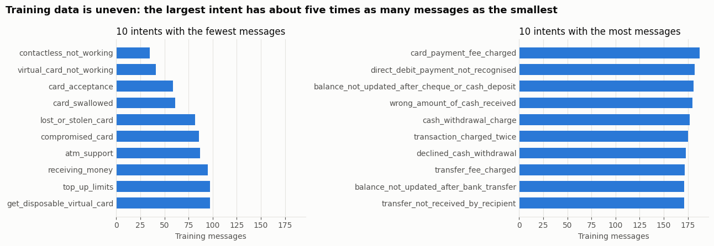
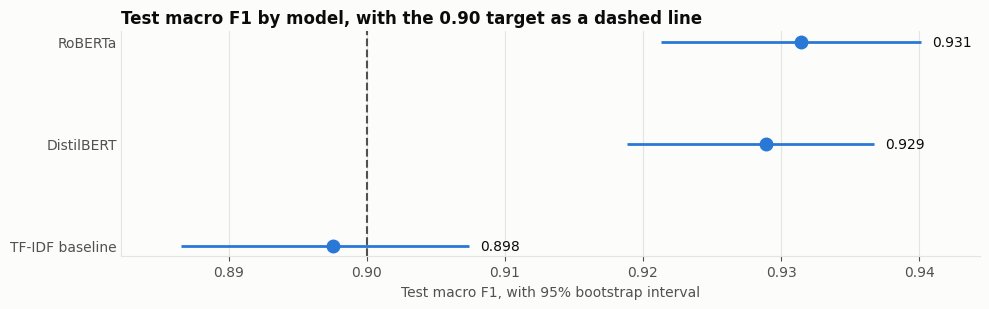
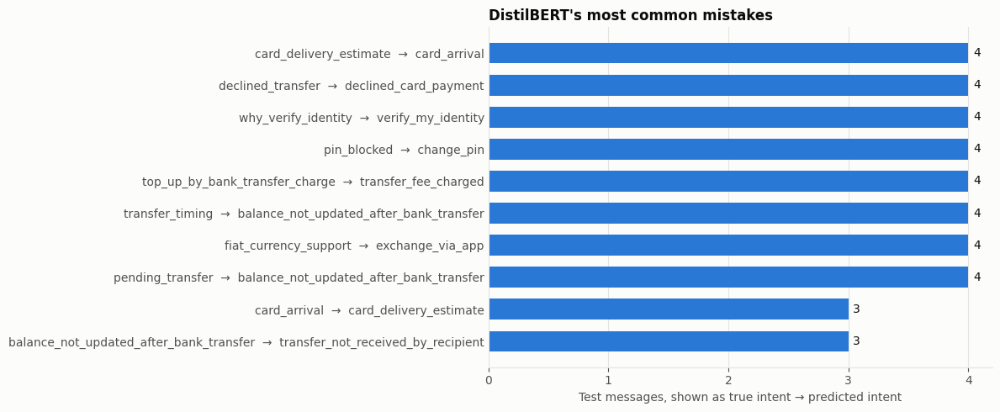
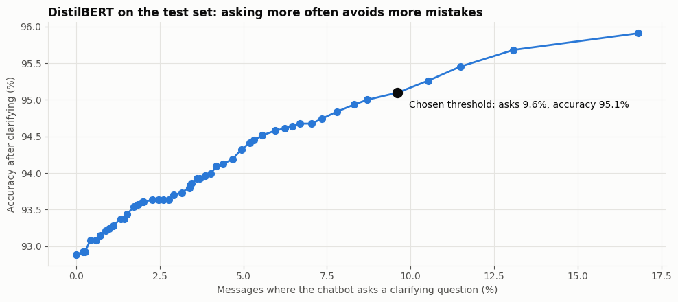

# Intent Classification for Banking Chatbots

**Individual NLP project, Project 7** · Yuvaraj Guliani · November 2026

Code and notebook: [github.com/yuvi1469/banking-intent-classifier](https://github.com/yuvi1469/banking-intent-classifier)

## 1. Summary

This project builds a classifier that reads a bank customer's message and predicts which of 77 intents it belongs to. Three models were compared on the BANKING77 dataset: a TF-IDF and logistic regression baseline, DistilBERT and RoBERTa.

| Model | Test accuracy | Test macro F1 | Median CPU time per message | Size |
|---|---|---|---|---|
| TF-IDF baseline | 0.897 | 0.898 | 1.1 ms | 1.4 MB |
| **DistilBERT (chosen)** | **0.929** | **0.929** | **57 ms** | **269 MB** |
| RoBERTa | 0.931 | 0.931 | 109 ms | 502 MB |

Both transformers clearly beat the baseline and pass the 0.90 target. RoBERTa and DistilBERT are statistically tied, so DistilBERT was chosen because it is about twice as fast and half the size.

Accuracy alone does not make a chatbot safe, so the project also tests clarifying questions, off-topic detection, typos, speed and limited training data. These results are combined in **BankBot Assistant**, a chat app that answers when confident, asks when unsure, and warns customers about lost or misused cards. On the test set it gives wrong answers on 2.8% of banking messages, compared with 7.1% if it always answered.

## 2. Problem

### 2.1 The task

Customers contact bank support with short, free-text messages. Before a chatbot can help, it has to work out what the customer wants. This is **single-label, multi-class text classification**: one message in, one of 77 intents out.

| Example message | Intent |
|---|---|
| "My card hasn't arrived yet" | `card_arrival` |
| "I think someone has been using my card" | `compromised_card` |
| "Why was I charged twice for the same purchase?" | `transaction_charged_twice` |

### 2.2 Users and their needs

| User | Need |
|---|---|
| Bank customers | Reach the right help quickly, without being sent to the wrong place |
| Support teams | Have routine requests handled automatically, and receive the cases that need a person |
| Chatbot developers | A model that is accurate, fast and clear about when it is unsure |

### 2.3 Constraints

- **Many similar classes.** 77 intents, several differing only in meaning, such as `card_arrival` (an expected card is missing) and `card_delivery_estimate` (how long delivery takes).
- **Short messages.** Half have 10 words or fewer, so there is little context.
- **Limited data.** About 13,000 labelled messages across 77 intents.
- **Informal text.** Real customers make typos.
- **Off-topic messages.** A real chatbot receives them, but BANKING77 has none.
- **Response time.** A chatbot has to reply quickly, ideally without a GPU.

### 2.4 Not all errors cost the same

| Severity | Example | Consequence |
|---|---|---|
| High | `lost_or_stolen_card` predicted as `card_not_working` | The card stays active, with a risk of financial loss |
| Medium | `transaction_charged_twice` predicted as `request_refund` | The customer gets the wrong process |
| Low | `card_arrival` predicted as `card_delivery_estimate` | The answer is closely related |

The system should therefore say when it is unsure, and evaluation has to look beyond overall accuracy.

### 2.5 Success criteria

These targets were set before any model was trained. Section 8 reports the outcome of each one.

| Requirement | Target |
|---|---|
| Macro F1 on the test set | At least 0.90 |
| Metrics reported | Accuracy, precision, recall and F1 |
| Compared with a simple approach | Higher macro F1 than the baseline |
| Consistency across intents | Lowest-scoring intents identified and explained |
| Prediction time for one message on a CPU | Under 200 ms |
| Off-topic handling | At least 80% flagged, under 10% of banking messages wrongly flagged |
| Usable by a person | A working app |

## 3. Dataset and preprocessing

### 3.1 Why BANKING77

BANKING77 (Casanueva et al., 2020) contains 13,083 online banking queries labelled with 77 fine-grained intents, released under CC BY 4.0. It suits the task because it covers a single domain in depth, so the intents are hard to separate, which is the real difficulty of a banking chatbot. It also has an official test set, so results can be compared with published work. The data was loaded from a pinned commit, so that it cannot change between runs.

### 3.2 What the data looks like

- The training data is uneven, from 35 to 187 messages per intent. The test set has exactly 40 per intent.
- Two high-risk intents are among the smaller ones: `lost_or_stolen_card` (82 messages) and `compromised_card` (86).
- There are no exact duplicates and no conflicting labels.

### 3.3 Preprocessing decisions

| Step | Decision | Reason |
|---|---|---|
| Label names | Two names fixed (`Refund_not_showing_up`, `reverted_card_payment?`) | Consistent naming |
| Cleaning | Whitespace only | Transformers benefit from natural text; case, punctuation, digits and currency symbols can all carry meaning |
| Near-duplicates | 12 removed within training | So that no message appears in both training and validation |
| Test leakage | 11 near-copies of test messages removed from training | So the test score is not inflated. The test set itself is unchanged |
| Validation split | 10%, stratified, seed 42 | Small intents keep their share |
| Token limit | 128 | The longest training message is under 100 tokens for both models, so nothing is cut off |

| Split | Messages | Used for |
|---|---|---|
| Training | 8,982 | Fitting the models |
| Validation | 998 | All tuning and threshold choices |
| Test | 3,080 | One final evaluation |

## 4. Models

| Model | Why it was included |
|---|---|
| **TF-IDF and logistic regression** | A fast, simple baseline, to show whether a transformer is worth its cost |
| **DistilBERT** (Sanh et al., 2019) | A smaller, faster version of BERT, suited to a chatbot that has to respond quickly |
| **RoBERTa** (Liu et al., 2019) | A larger model pre-trained on more text, to test whether extra capacity helps |

### 4.1 Training and tuning

All choices used the validation split only.

- **Baseline:** 12 settings of word n-grams, regularization strength `C` and class weights. Best: single words, `C` of 10, no class weighting.
- **Transformers:** learning rates of 2e-5, 3e-5 and 5e-5, up to 10 epochs, early stopping with a patience of 2, batch size 32, weight decay 0.01, one epoch of warmup and mixed precision, chosen by macro F1.

| Model | Best setting | Validation macro F1 |
|---|---|---|
| TF-IDF baseline | Single words, C = 10 | 0.870 |
| DistilBERT | Learning rate 5e-5, epoch 9 | 0.921 |
| RoBERTa | Learning rate 5e-5, epoch 8 | 0.934 |

## 5. Implementation

The project is one notebook, `notebooks/banking_intent_classifier.ipynb`, in 12 sections that run from top to bottom, with the app in `app/bankbot.py`.

- **Reproducible:** the seed is fixed, package versions are pinned in `requirements.txt`, and both datasets are loaded from pinned commits.
- **Modular:** each stage is built from small functions, such as `clean_text`, `tune_transformer`, `predict_probabilities` and `choose_clarify_threshold`. The app is a separate module, which the notebook downloads and imports.
- **Protected against mistakes:** checks stop the notebook if a message appears in more than one split, or if an intent is missing.
- **Re-runnable:** trained models and results are saved to Google Drive. With `RETRAIN = False`, **Run all** loads them instead of training again. The latest full run completed from top to bottom with no errors, and its test scores matched the earlier run that trained the models.

## 6. Evaluation

### 6.1 Test set results

Macro F1 is the main metric because it counts every intent equally. Precision, recall and F1 are macro averages.

| Model | Accuracy | Precision | Recall | Macro F1 | 95% range for macro F1 |
|---|---|---|---|---|---|
| TF-IDF baseline | 0.897 | 0.902 | 0.897 | 0.898 | 0.887 to 0.907 |
| DistilBERT | 0.929 | 0.932 | 0.929 | 0.929 | 0.919 to 0.937 |
| RoBERTa | 0.931 | 0.934 | 0.931 | 0.931 | 0.921 to 0.940 |

### 6.2 How certain are the differences?

The ranges come from 1,000 paired bootstrap resamples of the test set.

| Comparison | Difference in macro F1 | 95% range | Share of resamples ahead |
|---|---|---|---|
| DistilBERT minus baseline | 0.031 | 0.023 to 0.041 | 100% |
| RoBERTa minus baseline | 0.034 | 0.024 to 0.044 | 100% |
| RoBERTa minus DistilBERT | 0.003 | -0.005 to 0.010 | 74% |

Both transformers beat the baseline reliably. The difference between the two transformers includes zero, so they are effectively tied. Test scores are within about 0.01 of validation scores for both transformers, so there is no sign of overfitting to the validation split.

**Comparison with published work.** Casanueva et al. (2020) report test accuracies of 93.66% for fine-tuned BERT and 93.36% for their USE+ConveRT model. The 92.9% and 93.1% here are close, using a smaller training set (90% of the data, with validation held out) and a single run per setting, so the figures are not directly comparable.

### 6.3 High-risk intents

| Model | `lost_or_stolen_card` missed | `compromised_card` missed | Total |
|---|---|---|---|
| TF-IDF baseline | 3 of 40 | 4 of 40 | 7 of 80 |
| DistilBERT | 5 of 40 | 3 of 40 | 8 of 80 |
| RoBERTa | 3 of 40 | 6 of 40 | 9 of 80 |

The transformers' overall advantage does not appear on these two intents, although the samples are too small to rank the models. Missing even a few is serious for a bank, which is why the app adds a safety warning.

### 6.4 Error analysis

- **Errors follow similarity.** Nine of DistilBERT's ten most confused pairs are among the 100 most similar pairs of intents out of 2,926, as predicted during data exploration.
- **Transfers and top-ups are hardest.** Eight of the ten weakest intents concern them.
- **Many errors are hard for any model.** 115 test messages are wrong for all three models, about half of DistilBERT's 219 errors.
- **The transformers fix many baseline errors.** 141 messages are wrong only for the baseline. 37 are wrong only for DistilBERT and 47 only for RoBERTa.
- **Some labels look questionable.** "How do I top up my card?" is labelled `transfer_into_account`, and "Someone stole my cards!" is labelled `lost_or_stolen_phone`.
- **Single words can mislead.** "I think my child used my card while I wasn't home." was predicted as `age_limit`.

## 7. Additional evaluation dimensions

### 7.1 Clarifying questions

When the gap between the top two probabilities is small, the chatbot asks the customer which they mean. A separate threshold was chosen for each model on validation data, asking on at most 10% of messages.

| Model | Questions asked | Accuracy without asking | Accuracy with asking | Wrong answers |
|---|---|---|---|---|
| TF-IDF baseline | 10.8% | 0.897 | 0.925 | 230 |
| DistilBERT | 9.6% | 0.929 | 0.951 | 151 |
| RoBERTa | 9.7% | 0.931 | 0.959 | 126 |

Asking cuts DistilBERT's wrong answers from 219 to 151. RoBERTa gains most, so this is where it pulls ahead. These figures assume the customer always picks the right option.

### 7.2 Off-topic detection

BANKING77 has no off-topic messages, so the out-of-scope messages from CLINC150 (Larson et al., 2019) were used, removing any that mention banking words. A confidence threshold was set on validation data to wrongly flag 10% of banking messages.

| Model | Off-topic flagged | Banking wrongly flagged | AUROC |
|---|---|---|---|
| TF-IDF baseline | 91.5% | 11.6% | 0.962 |
| DistilBERT | 94.8% | 9.6% | 0.978 |
| RoBERTa | 96.9% | 10.3% | 0.978 |

Only DistilBERT meets both targets, and only just. CLINC150 messages are lowercase with no punctuation, so real off-topic messages may be harder to spot.

### 7.3 Robustness to typos

Typos were added with a fixed seed, using swaps, deletions, doubled letters and keyboard-neighbour replacements.

| Model | No typos | 1 typo | 2 typos |
|---|---|---|---|
| TF-IDF baseline | 0.898 | 0.806 | 0.712 |
| DistilBERT | 0.929 | 0.814 | 0.714 |
| RoBERTa | 0.931 | 0.858 | 0.783 |

This is DistilBERT's clearest weakness: with two typos its advantage over the baseline disappears.

### 7.4 Speed and size

Measured one message at a time on a CPU.

| Model | Median | Slowest 5% | Size |
|---|---|---|---|
| TF-IDF baseline | 1.1 ms | 1.3 ms | 1.4 MB |
| DistilBERT | 57.1 ms | 96.0 ms | 269 MB |
| RoBERTa | 108.8 ms | 183.5 ms | 502 MB |

All meet the 200 ms target. Timings vary between runs on Colab's shared CPUs.

### 7.5 Limited training data

| Training data | TF-IDF baseline | DistilBERT |
|---|---|---|
| 10 per intent (770 messages) | 0.718 | 0.626 |
| 30 per intent (2,310 messages) | 0.840 | 0.880 |
| All (8,982 messages) | 0.898 | 0.929 |

With very little data a simple model is the better start. A transformer becomes worthwhile at a few dozen examples per intent.

## 8. Results against the success criteria

| Requirement | Target | Result | Met? |
|---|---|---|---|
| Macro F1 on the test set | At least 0.90 | 0.929 (DistilBERT) | Yes |
| Metrics reported | All four | Section 6.1 | Yes |
| Compared with a simple approach | Higher than baseline | +0.031, ahead in 100% of resamples | Yes |
| Consistency across intents | Identified and explained | Section 6.4 | Yes |
| CPU prediction time | Under 200 ms | 57 ms median, 96 ms for the slowest 5% | Yes |
| Off-topic handling | At least 80% flagged, under 10% wrongly flagged | 94.8% flagged, 9.6% wrongly flagged | Yes, narrowly |
| Usable by a person | A working app | BankBot Assistant | Yes |

## 9. BankBot Assistant

BankBot Assistant is a chat app, built with Gradio, that turns the classifier into a working assistant using DistilBERT.

| Response | When |
|---|---|
| **Answer** | The model is confident, and one intent is clearly ahead |
| **Ask a clarifying question** | No intent is clearly ahead, but the top two together are likely. The customer replies with "1", "2" or the option's name, and the conversation carries on |
| **Ask to rephrase** | Even the top two together are unlikely, so the message may be off-topic |

Any message with a lost, stolen or misused card among the intents considered also gets a safety warning.

| Response to banking test messages | Share |
|---|---|
| Answered correctly | 87.2% |
| Answered wrongly | 2.8% |
| Clarifying question, right intent offered | 5.2% |
| Clarifying question, right intent not offered | 0.6% |
| Asked to rephrase | 4.1% |

About 97% of the answers it gives are right, at the cost of roughly one customer in ten having to reply once more. Of the off-topic test messages, 92.8% are asked to rephrase, 2.0% get a clarifying question and 5.2% are answered as if they were banking requests.

## 10. Discussion

### 10.1 What it does

It reads a customer's message, predicts the most likely of 77 banking intents with a confidence score, and decides whether to answer, ask or request a rephrase.

### 10.2 Why it works

- **Pre-training supplies meaning.** Transformers already understand language, so they can separate intents that share words but differ in meaning. The baseline depends on individual words, and the transformers fix 141 of its mistakes.
- **Fine-tuning supplies the domain.** A few thousand labelled messages are enough to adapt the model to 77 banking intents.
- **Confidence is informative.** Wrong predictions tend to have lower confidence and a smaller gap to the second choice, so thresholds can catch many errors before they reach a customer.

### 10.3 Limitations

- **Language and format:** English only, one intent per message, and no use of earlier conversation when classifying.
- **Label noise:** some test labels look questionable, which limits the score any model can reach.
- **Typos:** performance falls sharply with misspellings.
- **High-risk misses:** unusually worded reports can miss the safety warning altogether, as with "my child used my card". A customer with a lost card may also be asked to rephrase.
- **Confident mistakes:** "How long will it take for my new card to get here?" is answered as `card_arrival` with 98.9% confidence.
- **Off-topic data:** the test messages come from another dataset and are easier to spot than real ones.
- **Assumptions:** clarifying gains assume the customer picks correctly.
- **Single runs:** each setting was trained once, so differences between learning rates may be partly chance.
- **Scope:** BankBot identifies the intent, but does not carry out actions or give full answers. It is a course project, not a banking service.

### 10.4 Future work

- Train on typo-filled copies of the messages.
- Add keyword rules, so that high-risk messages still reach a person when the model misses them.
- Test with real off-topic messages sent to a banking chatbot.
- Combine DistilBERT and RoBERTa, since they make different mistakes.
- Compare with a large language model on accuracy, cost and speed.

## 11. Reproducing the results

See the [README](../README.md). The model card is in [model_card.md](model_card.md), and the presentation plan is in [demo_script.md](demo_script.md).

## References

- Casanueva, I., Temčinas, T., Gerz, D., Henderson, M., and Vulić, I. (2020). Efficient Intent Detection with Dual Sentence Encoders. *Proceedings of the 2nd Workshop on Natural Language Processing for Conversational AI*. arXiv:2003.04807.
- Larson, S., Mahendran, A., Peper, J. J., Clarke, C., Lee, A., Hill, P., Kummerfeld, J. K., Leach, K., Laurenzano, M. A., Tang, L., and Mars, J. (2019). An Evaluation Dataset for Intent Classification and Out-of-Scope Prediction. *Proceedings of EMNLP-IJCNLP 2019*.
- Liu, Y., Ott, M., Goyal, N., Du, J., Joshi, M., Chen, D., Levy, O., Lewis, M., Zettlemoyer, L., and Stoyanov, V. (2019). RoBERTa: A Robustly Optimized BERT Pretraining Approach. arXiv:1907.11692.
- Sanh, V., Debut, L., Chaumond, J., and Wolf, T. (2019). DistilBERT, a distilled version of BERT: smaller, faster, cheaper and lighter. arXiv:1910.01108.
- Wolf, T., et al. (2020). Transformers: State-of-the-Art Natural Language Processing. *Proceedings of EMNLP 2020: System Demonstrations*.
